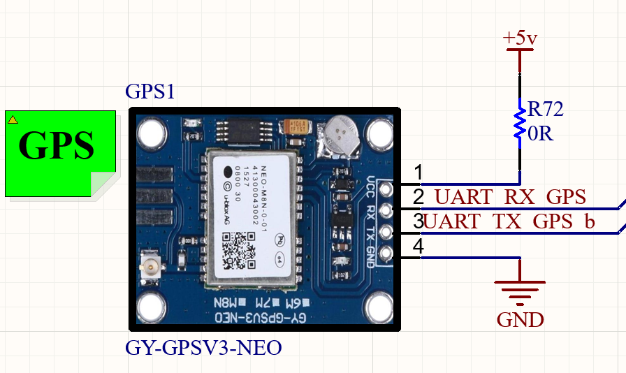

# GPS_ProcessData

VHDL design for receiving GPS serial data, extracting six time characters from RMC messages, buffering bytes for a DSP clock domain, and filtering an external PPS signal in two clock domains.

GitHub profile: [ramin-chegini](https://github.com/ramin-chegini).

This documentation change adds source comments, Markdown documentation, and ignore rules for generated Vivado files. HDL logic, interfaces, generic values, project settings, and IP configuration remain unchanged.

## Files and tools

| Path | Purpose |
| --- | --- |
| `HDL/GPS_Data_Proc.vhd` | Top-level `GPS_Data_Proc`: UART integration, RMC matching, time output, FIFO, and PPS filters |
| `HDL/uart_paritycheck_gps.vhd` | Configurable UART with RX, TX, and error checking; TX is disabled in the top level |
| `HDL/DebounceRise2.vhd` | Contains entity `Debounce_v2`, which filters the PPS level |
| `IP/UART_FIFO.xcix` | Independent-clock FIFO IP container, configured for 8-bit data and 512 entries |
| `Prj/GPS_ProcessData.xpr` | Vivado project with `GPS_Data_Proc` selected as the top module |
| [docs/ARCHITECTURE.md](docs/ARCHITECTURE.md) | Data flow, recognition conditions, and existing implementation limitations |

The project records **Vivado 2025.2** and target device **`xcku035-fbva900-1-c`**. It uses `UNISIM.FDCE` primitives and FIFO Generator IP. The upstream Digi-Key attribution and disclaimer in the UART source are preserved.

## GPS module connections

The supplied schematic image shows a `GY-GPSV3-NEO` module with these connections:

| Module pin | Schematic connection | Relation to this design |
| --- | --- | --- |
| 1, `VCC` | `+5V` through `R72 = 0R` | Module supply; no HDL port |
| 2, `RX` | Net `UART RX GPS` | GPS module receive input; this top level has no TX output |
| 3, `TX` | Net `UART TX GPS b` | GPS module transmit output; the FPGA receive path connects to `GPS_rx` |
| 4, `GND` | Ground | Common ground reference |

RX/TX labels are relative to the GPS module, so FPGA reception uses the module's TX pin. This table records the supplied schematic connections; it does not specify UART voltage levels. PPS is not shown on this four-pin connection, while `GPS_PPS_1s` is a separate HDL input. The supplied files do not define FPGA pin assignments or I/O standards.

## Top-level defaults

| Generic | Default | Meaning |
| --- | --- | --- |
| `clk_freq` | `20_000_000` | Expected `UART_Clk` frequency in hertz |
| `baud_rate` | `9_600` | Serial bit rate |
| `os_rate` | `16` | Receiver oversampling factor |
| `d_width` | `8` | Data width; top-level registers and FIFO are also fixed at 8 bits |
| `parity` | `0` | Parity disabled; default framing is 8N1 |
| `parity_eo` | `'0'` | Even parity when parity is enabled |

The standalone UART entity defaults to 125 MHz, 19200 baud, and enabled parity. `GPS_Data_Proc` overrides those defaults with the values above. This module does not generate its input clocks; `clk_freq` must match the actual `UART_Clk` frequency.

## Top-level interface

| Port | Direction | Function and clock domain |
| --- | --- | --- |
| `reset` | Input | Active-high reset; HDL process resets are asynchronous |
| `UART_Clk` | Input | UART, byte history, time extraction, and FIFO write clock |
| `clk_dsp` | Input | FIFO read, frame notification, and Comint PPS filter clock |
| `ADC_SamplingClk` | Input | Elint PPS filter clock |
| `GPS_PPS_1s` | Input | External PPS, independent of received UART text |
| `GPS_PPS_1s_Debunced_Elint` | Output | Filtered PPS level in `ADC_SamplingClk` |
| `GPS_PPS_1s_Debunced_Comint` | Output | Filtered PPS level in `clk_dsp` |
| `GPS_rx` | Input | Serial receive line from the GPS module's TX output |
| `GPS_buf_rd_en` | Input | FIFO read request in `clk_dsp` |
| `GPS_frame_tick_O` | Output | Notification from an exact `$GNRMC,` match through the `FDCE` register circuit |
| `GPS_buf_full_O` | Output | FIFO full indication in the `UART_Clk` write domain |
| `GPS_buf_data[7:0]` | Output | FIFO read data in `clk_dsp` |
| `GPS_TIME[47:0]` | Output | Six ASCII bytes in `HHMMSS` order, updated in `UART_Clk` |

For example, time characters `123519` map to `x"313233353139"` on `GPS_TIME`. The output holds ASCII characters rather than a binary timestamp or seconds counter. This is a format example, not a simulation result.

## Opening the project

1. Open `Prj/GPS_ProcessData.xpr` in Vivado.
2. Check that the top is `GPS_Data_Proc` and all three files in `HDL` are included. The entity inside `DebounceRise2.vhd` is named `Debounce_v2`.
3. Check that IP Sources contains `UART_FIFO` from `IP/UART_FIFO.xcix`. Use **Generate Output Products** if regeneration is needed. The XPR also references the XCI path extracted from the container.
4. For board integration, define clocks, generics, pin constraints, and timing constraints in the integrating project. The supplied `Constraints` directory is empty and the XPR has no active constraints.

Generated caches, runs, and IP output files are excluded from Git; the XPR and XCIX container are tracked. The supplied sources contain no dedicated testbench. Validation of this documentation change checks that non-comment HDL content and the original XPR/XCIX files are preserved; no new synthesis or hardware test is performed.

## Existing behavior

Time extraction and capture arming match `$G?RMC,`, where the character represented by `?` is not checked. `GPS_frame_tick_O` uses the stricter `$GNRMC,` condition. The logic does not check sentence checksums, position validity, or complete sentence boundaries.

The FIFO captures delayed bytes after recognition arms capture while the buffer is empty, and capture is disabled when the buffer becomes full. An NMEA sentence ending does not stop capture. FIFO empty and data counts are not exposed to the reader through this top-level interface. See the [architecture documentation](docs/ARCHITECTURE.md) for details, including existing clock-domain crossings.
